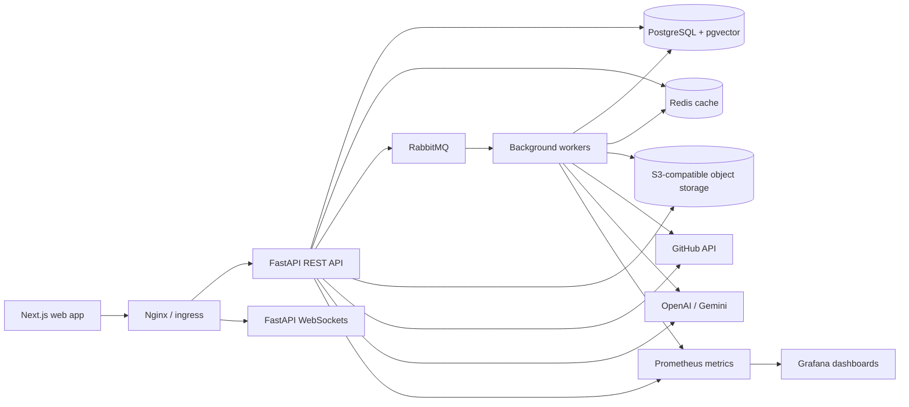
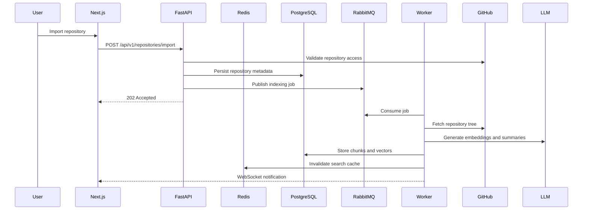
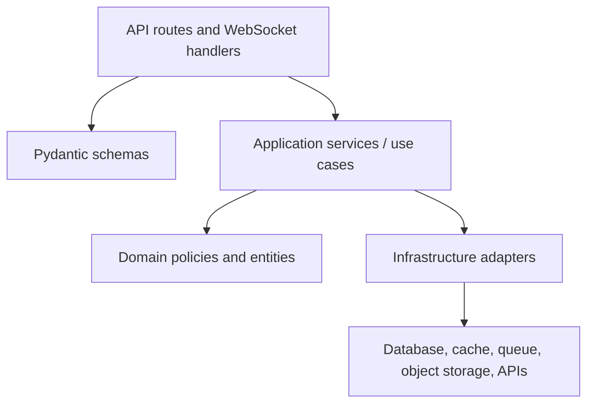
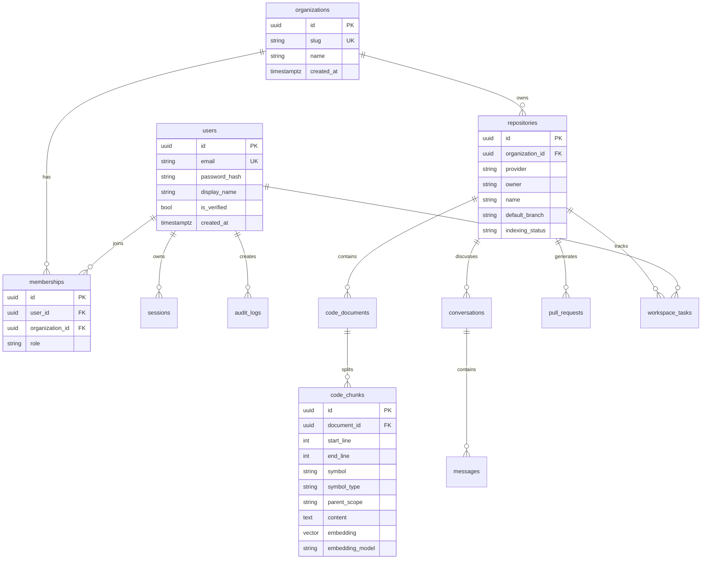

# Architecture

This project is a production-style AI software engineering workspace. It is a modular monorepo designed to run locally with Docker Compose and to deploy to Kubernetes without changing application code.

## High-Level System

## Why This Architecture Impresses Senior Reviewers

- The API is stateless and horizontally scalable; all durable state lives in PostgreSQL, Redis, RabbitMQ, and object storage.
- Repository indexing runs asynchronously through RabbitMQ so user-facing requests are low latency and resilient to LLM or GitHub slowness.
- PostgreSQL with pgvector is selected as the first vector database because it keeps transactional metadata and embeddings close together. At high scale, the same repository abstraction can move to a dedicated vector system such as Milvus, Vespa, or Pinecone.
- Redis is used only for hot-path cache, rate limiting, realtime presence, and idempotency keys; it is not the source of truth.
- Module boundaries mirror likely future services: auth, repositories, indexing, search, chat, pull requests, tasks, docs, realtime, and workers.
- Observability is a first-class concern: structured logs, health checks, readiness probes, Prometheus metrics, and trace-friendly request IDs.

## Request Flow

## Clean Architecture Layers

Routes validate transport concerns only. Services own business rules. Infrastructure adapters isolate GitHub, LLM providers, queueing, storage, cache, and vector search. This makes the system testable and leaves a path to extract services later.

## Data Model

## Milestone A: Repository Intelligence Architecture

### 1. Ingestion and Incremental Indexing
- **Content-addressed incremental updates**: Files are compared against indexed documents by content hash (`SHA-256`).
- **Zero-loss staging**: Unchanged files are skipped without re-embedding. Modified files replace their chunks within a transaction. Deleted files cascade cleanly.
- **Rollback preservation**: In the event of an ingestion or provider error, changes are rolled back to preserve the last valid index. The repository index is never deleted up front.
- **Model migration detection**: If `settings.embedding_model` differs from `repository.embedding_model`, the indexing engine triggers a safe full re-embedding to prevent mixed vector spaces.

### 2. Syntax-Aware Code Intelligence
- **Python**: AST-based parser extracting classes, sync/async functions, class methods, enclosing class scope (`parent_scope`), decorators, line boundaries, and imports. Gracefully falls back to bounded chunking on syntax errors.
- **TypeScript & JavaScript**: Syntax parser extracting interfaces, classes, type aliases, functions, arrow functions, and methods with accurate line numbers and scope.
- **Sub-chunking**: Oversized declarations (>100 lines) are sub-chunked into bounded segments while retaining `symbol`, `symbol_type`, and `parent_scope`.

### 3. Real Embedding Providers
- **Provider abstractions**: Pluggable providers (`OpenAIEmbeddingProvider`, `GeminiEmbeddingProvider`, `DeterministicMockEmbeddingProvider`).
- **Configuration & Secrets**: Explicit provider selection via `EMBEDDING_PROVIDER` and model via `EMBEDDING_MODEL`. Credentials stored in `SecretStr`.
- **Dimension validation**: Strict checks against configured `EMBEDDING_DIMENSIONS`.
- **Resilience**: Exponential backoff on rate limits (HTTP 429) and transient errors, with batching to avoid payload caps.
- **Composite Caching**: Two-tier caching (Redis + in-memory LRU fallback) keyed by `embed:{provider}:{model}:{sha256(content)}`.

### 4. Hybrid Retrieval & Reciprocal Rank Fusion (RRF)
- Combines semantic vector search (`cosine_distance`), PostgreSQL full-text search (`to_tsvector` and `plainto_tsquery`), and exact identifier matching.
- Rank Fusion formula:
  $$\text{score}(d) = \sum_{m \in M} \frac{w_m}{k + \text{rank}_m(d)}$$
  with $k=60$ and weights: semantic ($1.0$), lexical ($0.8$), symbol ($1.2$).
- Multi-tenant isolation: Organization and repository boundaries enforced on every retrieval branch.
- Versioned cache keys: Include `last_indexed_commit` and `embedding_model` for deterministic cache invalidation upon re-indexing.

### 5. Worker Concurrency and Distributed Locking
- **Distributed Lock**: Redis-backed distributed lock with UUID token verification and atomic Lua release (`lock:indexing:{repository_id}`) with 300s TTL.
- **Idempotency**: Succeeded jobs are deduplicated and acknowledged without re-execution. Interrupted/crashed jobs with expired locks are recovered safely.

## Low-Latency Choices

- Auth and organization permissions are cached with short TTLs and invalidated on membership changes.
- Search uses pgvector HNSW indexes for approximate nearest neighbor queries.
- Long-running operations return `202 Accepted` and publish worker jobs.
- WebSocket channels carry job progress and presence without polling.
- API pagination uses keyset-friendly IDs and indexed timestamp columns.

